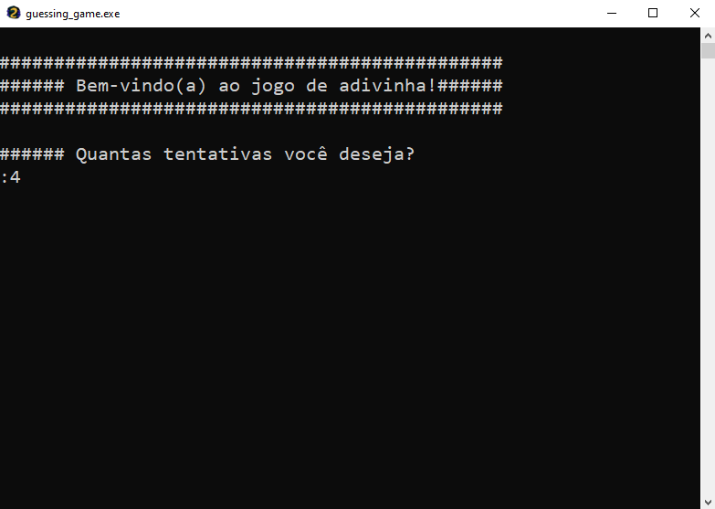

# Jogo de Adivinha em Python 🐍
Teste se você consegue coincidir seus números com a máquina!

## Como funciona ❓

- Registra a quantidade de tentativas que você deseja para continuar jogando.
- O jogo termina assim que os números coincidirem ou as tentativas se esgotarem.
- Assim que o jogo termina, surge a opção entre **Jogar Novamente** ou **Desistir**.
> (Optar por desistir fechará o programa.)
- Deverá escolher apenas um número inteiro, entre 1-10.
```python
Permitido: 3, 4, 7, 10.

Não permitido: 0, 3.14, 12.
```

## Pré-requisitos 🛑
De acordo com como deseja rodar

### Arquivo Executável Windows (.exe)
- Windows 10/11
- Não é necessário instalar o Python.

### Executar diretamente do código-fonte
- Python 3.15
- Nenhuma dependência externa é necessária.

### Compilar do código-fonte
- PyInstaller 

## Instalação 🔌

Clone o repositório:

```bash
git clone https://github.com/moraes404/adivinha-em-python
```
Rode o programa:

```bash
cd src\
python guessing_game.py
```

## Download ⏬
### Você também pode baixar o executável para Windows na aba [Releases]()

## Compilar do código fonte 🔨

Primeiro, instale a dependência necessária:

```bash
pip install -r requirements-dev.txt
```

Rode o comando, para uma compilação limpa:

```bash
pyinstaller --onefile --console --clean --noconfirm --icon=assets\icon.ico 'src\guessing_game.py'
```